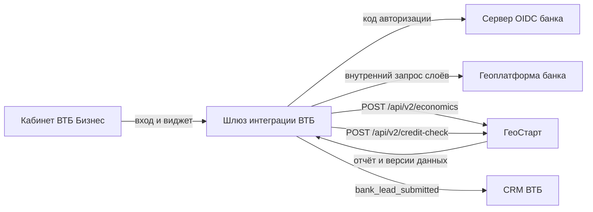
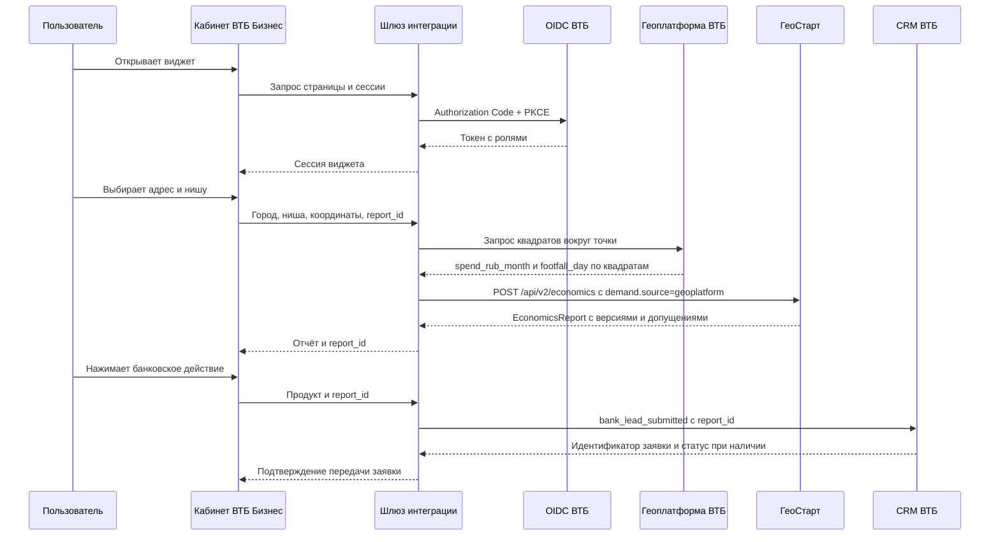

# Интеграция ГеоСтарта с ВТБ Бизнес

Документ описывает целевую схему пилота S2-П1. Кабинет ВТБ Бизнес и геоплатформа банка остаются внутри контура ВТБ. ГеоСтарт получает подготовленные агрегаты спроса по квадратам 500×500 м, рассчитывает финансовый отчёт и возвращает его в кабинет через шлюз интеграции. Прямых запросов из ГеоСтарта к геоплатформе, CRM и внешним API нет.

## Границы компонентов



| Компонент | Ответственность | Данные, которые покидают компонент |
| --- | --- | --- |
| Кабинет ВТБ Бизнес | вход пользователя, выбор города, ниши и адреса, показ отчёта, переход к банковскому действию | запрос виджета и обезличенный идентификатор отчёта в шлюз |
| Шлюз интеграции ВТБ | проверка сессии, вызов геоплатформы, преобразование данных, корреляция отчёта и события CRM | агрегаты квадратов в запрос ГеоСтарта, идентификатор отчёта в CRM |
| Геоплатформа банка | выдача трат категории и трафика по квадратам 500×500 м | агрегаты, отобранные шлюзом |
| ГеоСтарт | расчёт спроса и финансовой модели, проверка бизнес-плана, источники и версии в ответе | JSON-отчёт и технические журналы без клиентских полей |
| CRM ВТБ | фиксация перехода к РКО, эквайрингу или кредиту и последующего статуса | банковский идентификатор клиента и идентификатор отчёта |
| Сервер OIDC банка | аутентификация и выдача ролей | токен доступа с ролями ГеоСтарта |

Клиентский идентификатор и бизнес-план остаются в системах ВТБ. ГеоСтарт получает только поля, необходимые для расчёта, и не обращается к CRM самостоятельно.

## Последовательность вызовов



Запрос к ГеоСтарту выполняется только после получения квадратов от геоплатформы. Если геоплатформа не вернула покрытие точки, шлюз не подставляет нулевые траты и сообщает об отсутствии данных. В качестве альтернативы для технической проверки допускается `demand.source=geostart`, при котором используется открытая модель ГеоСтарта.

## Запрос к ГеоСтарту

Шлюз передаёт токен доступа банка в заголовке `Authorization`. Поле `aud` токена равно значению `GEOSTART_OIDC_AUDIENCE`, а роли сопоставляются с разрешениями через `GEOSTART_OIDC_ROLE_MAP`. Заголовки корреляции не участвуют в расчёте.

| Заголовок | Требование |
| --- | --- |
| `Authorization` | `Bearer` токен сервера OIDC банка |
| `X-Report-ID` | непрозрачный UUID отчёта, созданный шлюзом |
| `X-Request-ID` | UUID отдельного HTTP-запроса |
| `Content-Type` | `application/json` |

Пример тела запроса:

```json
{
  "city": "tula",
  "niche": "coffee",
  "demand": {
    "source": "geoplatform",
    "lat": 54.1931,
    "lon": 37.6173,
    "provider": "vtb-geoplatform",
    "squares": [
      {
        "square_id": "7_12",
        "south": 54.1890,
        "west": 37.6090,
        "north": 54.1935,
        "east": 37.6167,
        "spend_rub_month": {"p10": 1800000, "p50": 2400000, "p90": 3100000},
        "footfall_day": {"p10": 4200, "p50": 5600, "p90": 7300}
      }
    ]
  },
  "premises": {"area_m2": 40},
  "financing": {"product": "vtb_express", "loan_share": 0.7},
  "tax": {"legal_form": "ip", "regime": "auto"},
  "horizon_months": 36,
  "start_month": 1,
  "start_year": 2027
}
```

Формат `demand.geoplatform` и ограничение до 400 квадратов описаны в [contracts.md](contracts.md). Ответ содержит `versions`, `demand`, `tax`, `investment`, `metrics`, `credit`, `monthly`, `years`, `assumptions` и `warnings`. Шлюз сохраняет `report_id` вместе с кратким техническим статусом, а полный отчёт возвращает в кабинет по защищённой сессии.

Текущая реализация API принимает `X-Report-ID` как транспортный заголовок без включения его в финансовую модель. Сохранение связи с CRM и запись банковского события выполняются на шлюзе интеграции, который в репозитории не реализован. Перед пилотом ВТБ должен подтвердить формат заголовка и срок хранения связи.

## Событие CRM

Переход к банковскому продукту передаётся из шлюза в CRM. В событии не передаются координаты и финансовые поля отчёта.

```json
{
  "event": "bank_lead_submitted",
  "report_id": "2e2e2b6f-8b2b-49f6-8f5d-96ef6ce2b1d2",
  "customer_ref": "bank-internal-id",
  "product": "credit",
  "city": "tula",
  "niche": "coffee",
  "occurred_at": "2026-11-27T12:00:00Z"
}
```

`customer_ref` обрабатывается только в контуре ВТБ. Для повторной отправки шлюз использует пару `report_id` и `product`, чтобы не создавать дубликат события. Ответ CRM содержит внутренний идентификатор заявки и технический статус, который можно показать пользователю без раскрытия банковских причин отказа.

## Единый вход и права

OIDC настраивается по правилам [auth.md](auth.md). Для пилота нужны следующие соответствия:

| Действие | Роль ГеоСтарта | Разрешение |
| --- | --- | --- |
| карта и отчёт | `entrepreneur` | `view_map`, `location_report` |
| проверка бизнес-плана | `credit_officer` | `credit_check` |
| сводная статистика | `analyst` | `access_stats` |
| журнал обращений | `admin` | `access_log` |

Вход выполняется через сервер OIDC банка по authorization code с PKCE. Шлюз не передаёт в ГеоСтарт токен, предназначенный для CRM или геоплатформы. Для межсервисных вызовов используются отдельные получатели токенов и сетевые правила контура.

## Развёртывание в контуре банка

Минимальная схема развёртывания состоит из входного прокси банка, шлюза интеграции, контейнеров ГеоСтарта, PostgreSQL с PostGIS при включённом режиме хранения и локального сервера тайлов. Геоплатформа, OIDC и CRM доступны только по внутренним адресам ВТБ. ГеоСтарт не имеет маршрута в интернет.

1. Банк размещает ГеоСтарт и шлюз в закрытом сегменте и задаёт `GEOSTART_PUBLIC_URL`.
2. ВТБ регистрирует OIDC-клиента с callback `https://<адрес ГеоСтарт>/api/auth/callback` и ролями из таблицы выше.
3. Шлюз проверяет сертификат ГеоСтарта и передаёт только токены с нужным `aud`.
4. Данные и образы загружаются заранее по процедуре [release.md](release.md), после чего шлюз проверяет версии `model`, `norms`, `data` и `taxes` в ответе.
5. Входной прокси ограничивает размер тела, частоту запросов и доступ к административным путям.

Секреты OIDC, ключи сессий, пароли базы и сертификаты хранятся в секретном хранилище ВТБ. Значения из `.env.example` применяются только для локального стенда.

## Обновление нормативов и данных

Нормативы ниш обновляются в `research/economics/norms.yaml`, параметры налогов и кредитных продуктов имеют собственные версии. Перед публикацией выполняется команда:

```text
uv run python -m geostart.release rebuild --city all --skip-pipeline
uv run python -m geostart.release package --output dist --with-basemap
```

После проверки качества банк получает архив данных с манифестом и контрольными суммами. Шлюз не меняет нормативы в запросе. ГеоСтарт отдаёт версию нормативов в каждом финансовом ответе, а оператор пилота фиксирует её в журнале релиза. При ошибке проверки новая версия не выкладывается, текущие данные остаются активными.

## Ошибки и повторные запросы

| Ситуация | Ответ ГеоСтарта | Действие шлюза |
| --- | --- | --- |
| токен отсутствует или просрочен | 401 | обновить сессию через OIDC и повторить вход |
| роль не разрешает действие | 403 | показать отказ без повторной отправки |
| город, ниша или данные не найдены | 404 | показать отсутствие покрытия и сохранить `report_id` для диагностики |
| параметры запроса некорректны | 422 с `application/problem+json` | исправить запрос, повтор без изменения запрещённого поля |
| база или данные временно недоступны | 503 | повторить до трёх раз с интервалами 1, 2 и 4 секунды |

Повтор экономического расчёта использует тот же `X-Report-ID`. Событие CRM отправляется после успешного ответа кабинета и повторяется идемпотентно по паре `report_id` и `product`.

## Границы ответственности

Шлюз интеграции и CRM-события разрабатывает ВТБ. ГеоСтарт отвечает за API v2, авторизацию OIDC, расчёт, версии нормативов, журнал обращений и автономную работу в контуре. До начала пилота стороны отдельно согласуют формат `report_id`, перечень полей CRM-события, сетевые ACL, сроки хранения журнала и процедуру отката версии данных.
