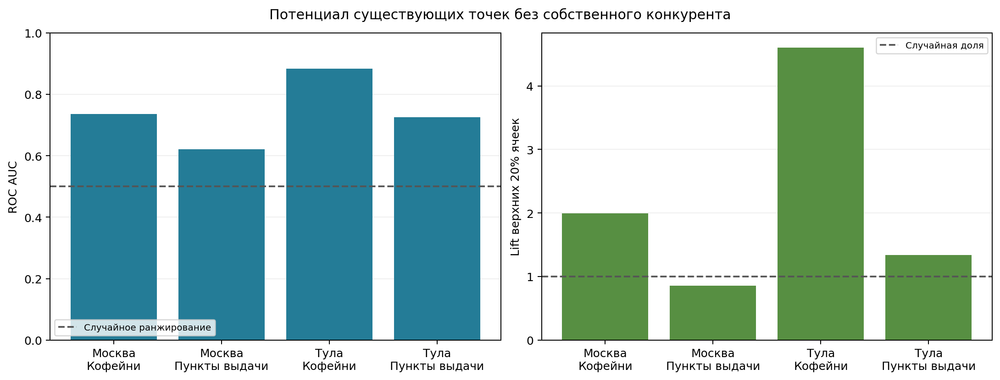
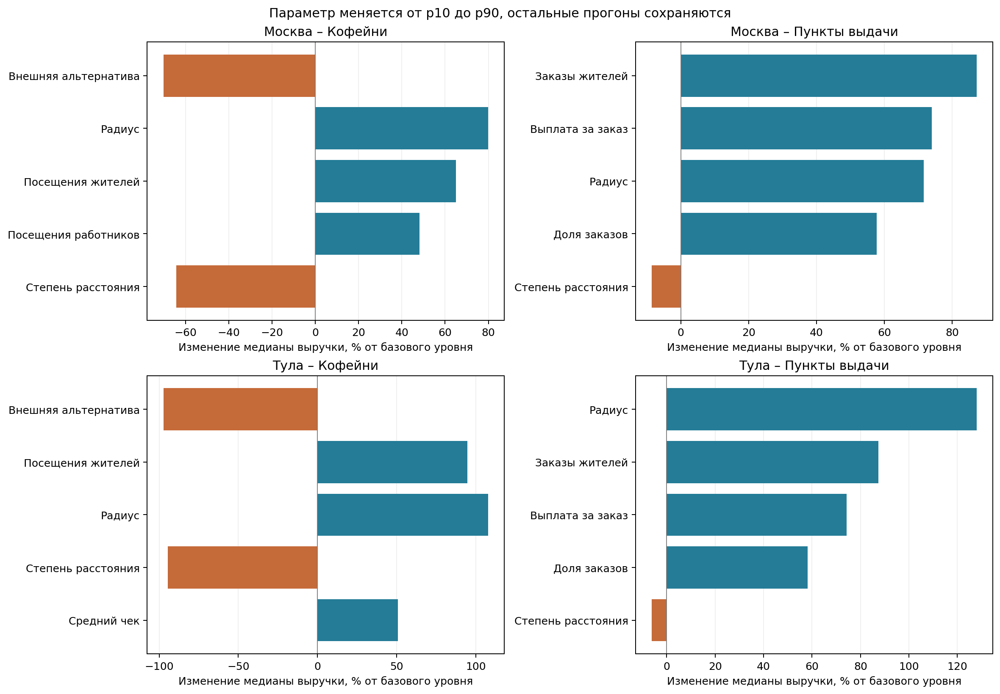
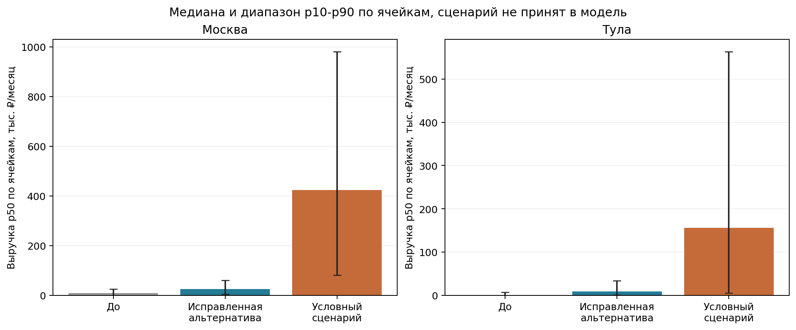
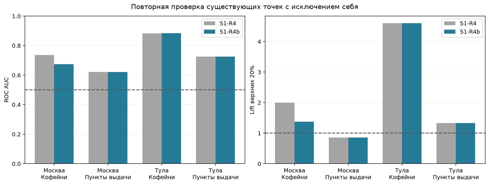
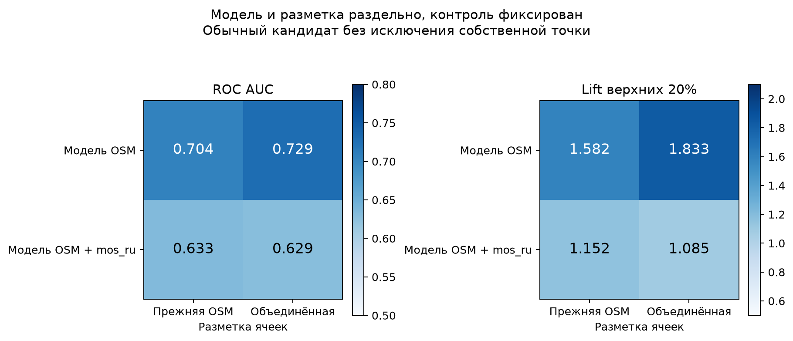
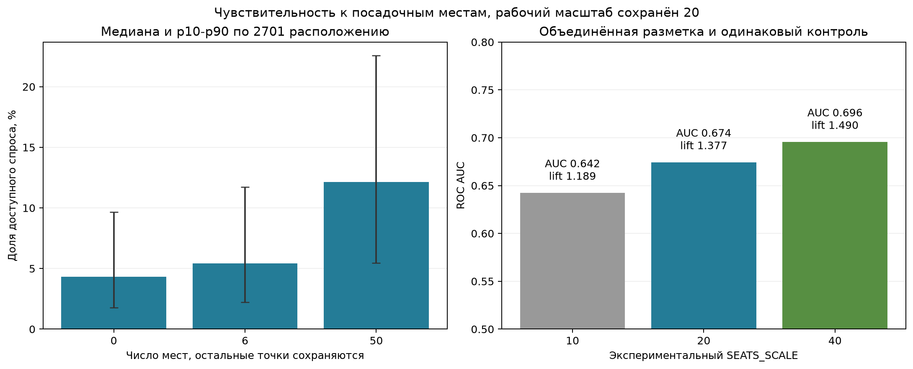
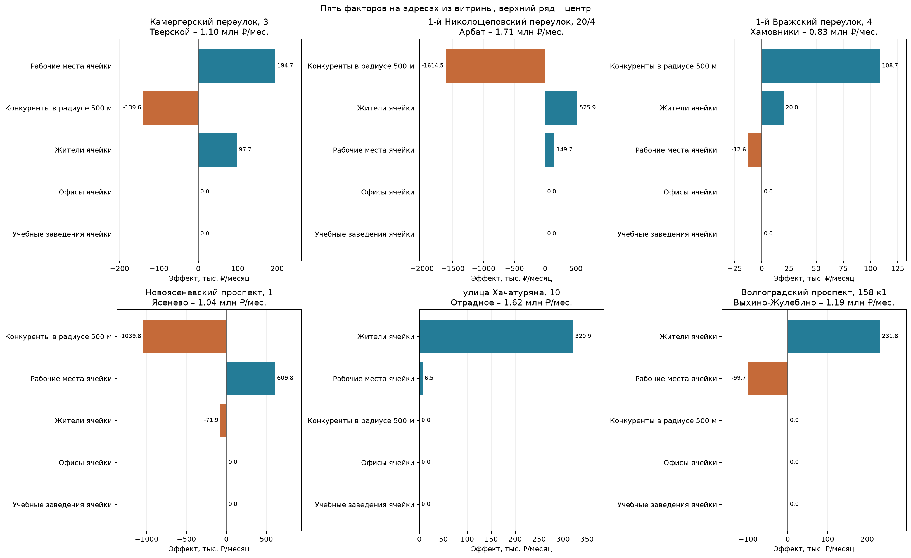
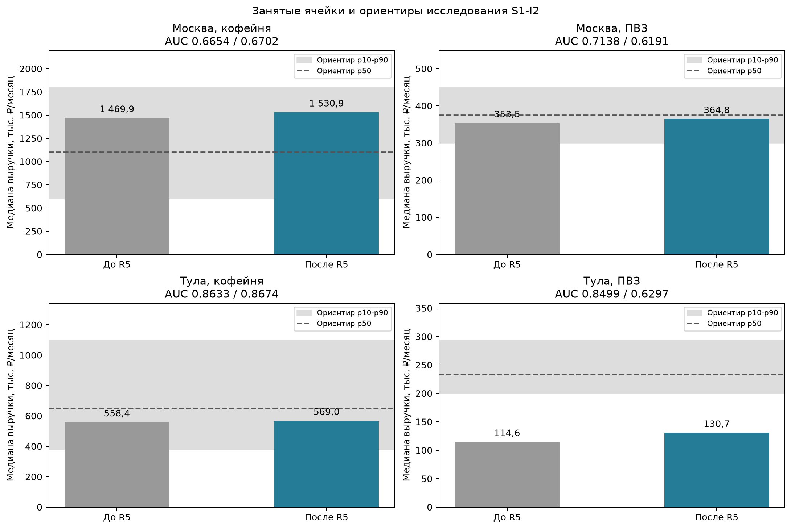

# Расчётная модель ГеоСтарта

## Спрос

`demand.py:simulate_demand` принимает признаки ячеек, конкурентов, код ниши и блок `demand` из исследования. Результат содержит H3 и месячную выручку p10, p50, p90. По умолчанию выполняются 200 независимых прогонов с seed 2026. Параметры каждого прогона независимо выбираются равномерно между p10 и p90. Поле p50 исследования не задаёт центр равномерного распределения. Квантили результата описывают разброс условных параметров, статистическим доверительным интервалом они не служат.

Параметры ниш взяты из исследования Ивана S1-I2. `geostart.research.city_parameters` выбирает поля с суффиксом города в блоках спроса, расходов, капитальных затрат и ориентиров. `service.py:load_inputs` передаёт модели уже подставленные значения. Налоги остаются `placeholder`, подгонка налогов не выполняется. Москва использует районную калибровку жителей, ставки аренды получены из выборки Циан. Оговорки выборки описаны в `research/rent/notes.md`.

Для кофейни месячные посещения равны `residents × visits_per_resident_month + workers × visits_per_worker_month + metro_visits_per_month × max(0, 1 - metro_dist_m / metro_influence_distance_m) + transit_stops_n × transit_visits_per_stop_month`. Сумма умножается на `avg_check_rub`. Пропуск метро даёт нулевой вклад метро, пропуск числа остановок – нулевой вклад остановок. Дополнительный спрос прохожих служит допущением, возможен повторный учёт жителей и работников. Для пункта выдачи число заказов жителей умножается на долю получения в ПВЗ и выплату за заказ. Рабочие места в спрос пункта выдачи не входят. Жители уже откалиброваны конвейером, повторная нормировка не выполняется.

`demand.py:prepare_model` строит список соседей через H3 `grid_disk`, затем отсекает пары по расстоянию между центрами ячеек. Конкуренты за пределами таблицы признаков тоже учитываются. Для сетки разрешения 9 Москвы и Тулы радиус сеточного поиска выбирается с запасом относительно средней длины ребра. Полной матрицы расстояний города нет. Таблица соседей строится один раз на максимальный радиус перебора, каждый прогон применяет собственное ограничение расстояния.

Вес точки равен привлекательности, умноженной на `(max(distance_m, 100) / 100) ** (-distance_decay_beta)`. Нижняя граница 100 м устраняет бесконечность внутри одной ячейки и служит допущением модели. Привлекательность OSM равна 1 независимо от числа мест. Для `mos_ru` она равна `1 + seats / 20`, пустое число мест даёт 1. Отрицательные места приравниваются к нулю. Масштаб 20 мест служит условным значением до проверки исследования.

Доля кандидата равна его весу, делённому на сумму собственного веса, весов существующих конкурентов и `outside_option_weight`. Каждый кандидат оценивается как отдельное возможное открытие. Кандидаты карты друг с другом не конкурируют, сумму их выручки нельзя считать выручкой города. Привлекательность кандидата по умолчанию равна 1, `DemandModel.revenue` принимает другое положительное значение.

Параметр `outside_option_weight` допускает диапазон p10-p90 в передаваемом блоке. Значения исследования имеют приоритет над запасными параметрами `src/geostart/model/niche_defaults.yaml`. В исследовании S1-I2 кофейня использует диапазон 0,5-1,5, пункт выдачи – 0,01-0,10. Запасной диапазон ПВЗ 0-0,000002 используется только при отсутствии параметра. Нулевой вес допускается для пункта выдачи, отсутствие доступных весов даёт нулевую долю. Для кофейни вес строго положительный. `assumptions.py:demand_assumptions` отражает допущения соответствующей ниши в отчёте.

Для ПВЗ сохранён Хафф в пешем радиусе. Если ни одного пункта в нём нет, выбираются ближайшие пункты в пределах `max_pickup_distance_m`. Их расстояния сравниваются по центрам H3, точки на одинаковом расстоянии делят спрос пропорционально привлекательности. Общий вес расстояния ближайших пунктов нормируется к 1, внешняя альтернатива сохраняет значение Ивана. При весе 0,05 единственный ближайший пункт получает `1 / 1,05` такого спроса. За пределами расширенного радиуса спрос остаётся внешней альтернативе. При оценке нового кандидата доступность пересчитывается с его участием. Кандидат в пешем радиусе имеет приоритет, более близкий кандидат в расширенном радиусе заменяет прежний ближайший пункт. Сумма гипотетических открытий по-прежнему не складывается в рынок.

`assumptions.py:wage_assumptions` объясняет зарплату на основе соседней профессии при `basis = proxy`. `assumptions.py:resolve_rent` берёт ставку p50 района, при её отсутствии возвращает медиану положительных ставок p50 города и допущение. Таблица аренды передаётся для одного города. В v2 учтены 3709 кофеен Москвы и 47 кофеен Тулы. Разметка OSM Тулы остаётся неполной.

Проверка и замер выполняются из корня клона. Модель загружает `.env` из корня клона без замены уже заданных переменных окружения. Каталоги определяются через `geostart.settings.processed_dir(city)` и `geostart.settings.data_dir()`. Для данных вне клона задайте `GEOSTART_DATA_DIR` в `.env`. Параметр `--data-dir` служит необязательной заменой для команды замера. Команды читают исходные файлы без записи.

```powershell
uv run pytest tests/test_demand.py
uv run python -m geostart.model.benchmark --city moscow --niche coffee
uv run python -m geostart.model.benchmark --city moscow --niche pickup_point
```

## Финансовый расчёт

`src/geostart/model/finance.py:calculate_finance` рассчитывает каждый прогон по той же выручке, которая используется для квантилей. Площадь, численность сотрудников, доля себестоимости, прочие расходы и капитальные затраты выбираются равномерно между p10 и p90 исследования. Для расходов используется отдельный поток генератора с seed 2026. Численность сотрудников трактуется как эквивалент полной занятости и допускает дробное значение. Зарплата равна salary_p50 нужной профессии. Аренда района сохраняет ставку p50, недостающие районы получают городскую медиану p50. Пользовательские площадь и ставка аренды фиксируются во всех прогонах.

Месячная аренда равна площади, умноженной на ставку. Расходы на сотрудников равны численности, умноженной на зарплату и на сумму 1 и ставки взносов работодателя. Себестоимость равна выручке, умноженной на её долю. Прочие расходы берутся из исследования.

Для режима `usn_income_6` налог равен налогу с дохода за вычетом взносов работодателя в пределах 50% исходного налога. Для `usn_income_minus_expenses_15` налог равен большей из величин налога с положительной разницы доходов и расходов и 1% выручки. Минимальный годовой налог распределяется на месяцы при допущении постоянного месяца. Правила уменьшения и минимального налога проверены по [пояснениям ФНС об УСН](https://ausn.nalog.gov.ru/create_business/ul/in_progress/usn/step3/). Сами ставки читаются из `research/taxes/2026.yaml` и пока условные.

Прибыль каждого прогона равна выручке за вычетом всех расходов. Риск равен `high` при доле убыточных прогонов выше 0,5, `medium` при доле 0,2-0,5 включительно и `low` ниже 0,2. Нулевой результат не считается убытком. Для показателей отчёта медианы отдельных статей расходов суммируются в `costs_month.total`. Показанная прибыль `profit_month_p50` равна показанной `revenue_month.p50` за вычетом этой суммы. Она служит согласованным денежным итогом и может отличаться от медианы прибыли по прогонам. Окупаемость равна `capex_rub_p50 / profit_month_p50`, при неположительной прибыли отсутствует. Такое же правило действует для прибыли и окупаемости в scores. Сценарное распределение сохраняется для риска и диапазона выручки.

Годовая выручка для проверки НДС равна выручке p50, умноженной на 12. Превышение порога исследования добавляет предупреждение в `assumptions`. НДС не включается в расходы, взносы самого ИП не моделируются, сезонность отсутствует. Торговый сбор текущего исследования не применяется к обеим нишам. Налоговые значения с `status: placeholder` не заменяются справочными ставками без обновления исследования.

## Факторы

`src/geostart/model/factors.py:explain_factors` использует те же 200 наборов параметров, что и исходный отчёт. Эффект равен исходной выручке p50 за вычетом выручки p50 при замене одного признака медианой города. Для жителей, рабочих мест, расстояния до метро и числа остановок меняется только собственная ячейка кандидата. Источники спроса соседних ячеек сохраняются. Офисы, образование и торговые центры не входят в формулу спроса, их эффект равен нулю. Метро и остановки влияют на спрос только кофейни. Пропуски метро исключаются из списка факторов. При равных эффектах транспортные признаки показаны перед неиспользуемыми признаками, что сохраняет метро в топ-5 адреса без близкой станции.

Число конкурентов в пределах 500 м считается по координатам точек относительно центра ячейки. Для сравнения берётся медиана района `district`, если в нём есть не менее 30 ячеек. Для меньших районов используется медиана города. Привлекательность ближайших конкурентов масштабируется пропорционально новому числу, положение точек и влияние дальних конкурентов сохраняются. Если ближайших точек нет, создаётся условная совокупная привлекательность в центре ячейки. Одно число конкурентов не определяет их координаты, размещение служит допущением. Эффект равен фактической выручке p50 за вычетом выручки сценария с медианным числом конкурентов. Если конкурентов меньше базы, эффект положительный, если больше – отрицательный, при равенстве – нулевой. Число мест меняет величину эффекта, сохраняя его направление. Внешняя альтернатива в обоих сценариях одинакова. Эффект конкурентов ограничивается диапазоном от минус выручки p50 до плюс выручки p50. После ограничения он служит ограниченной оценкой разницы сценариев. Факторы сортируются по модулю эффекта и не складываются в объяснение всей выручки.

## Расчёт города и отчёт точки

Публичные функции `geostart.model.score_city` и `geostart.model.evaluate_location` имеют сигнатуры контракта. `score_city` записывает восемь полей в `data/scores/<city>_<niche>.parquet`, путь определяется через настройки. `evaluate_location` возвращает `geostart.schemas.LocationReport` без изменения общей схемы. Он проверяет точку по границе GeoJSON и считает спрос в центре её H3. Для отчёта берётся только область источников спроса в пределах максимального радиуса, конкуренты соседних областей остаются в знаменателе Хаффа. Сравнение с полным расчётом города проверяется тестами.

Если внутри границы нет строки признаков H3, собственный спрос считается нулевым, соседний спрос сохраняется, аренда берётся по городской медиане. Такое решение учитывает пустые ячейки Тулы, которые конвейер отбросил. Отчёт объясняет отсутствие признаков. Адрес выбирается как ближайший из известных в той же ячейке и отсутствует, если таких адресов нет. Версия данных равна последней дате сбора вакансий.

`service.py:report_assumptions` объединяет готовые функции допущений S1-R1 с источниками расходов и налогов. В отчёте отмечаются зарплаты proxy, ставки аренды по городской медиане, условные исследования и пользовательские значения. Реальные processed-файлы команда не изменяет, результаты записываются только в scores.

```powershell
uv run python -m geostart.model score --city all --niche all
uv run pytest tests/test_finance.py tests/test_model.py
```

## Замеры на реальных данных

Замеры выполнены 2026-10-14 последовательно на Windows 10, Python 3.13.3. Время включает загрузку, построение соседей, 200 прогонов, подсчёт конкурентов и запись Parquet. Таблица показывает квантили распределения выручки p50 по ячейкам города, отдельные от квантилей неопределённости каждой ячейки.

| Город и ниша | Ячеек | Время, с | p10 выручки ячеек, ₽ | Медиана, ₽ | p90, ₽ | low | medium | high |
| --- | --- | --- | --- | --- | --- | --- | --- | --- |
| Москва, coffee | 8717 | 6,779 | 79 966,36 | 1 465 950,58 | 2 922 906,85 | 3097 | 1797 | 3823 |
| Москва, pickup_point | 8717 | 9,772 | 303,88 | 8802,93 | 24 869,73 | 0 | 0 | 8717 |
| Тула, coffee | 3029 | 1,823 | 1239,49 | 57 231,53 | 677 753,02 | 237 | 165 | 2627 |
| Тула, pickup_point | 3029 | 2,630 | 21,07 | 622,52 | 6805,78 | 0 | 0 | 3029 |

Все пункты выдачи получили высокий риск при текущих условных параметрах. Низкие оценки выручки требуют проверки параметров выплат и числа заказов, а также калибровки модели. Для кофеен Тулы неполная разметка конкурентов завышает долю кандидата. Качество прогноза на существующем бизнесе в S1-R2 и S1-R3 не оценивалось.

## Качество модели

Разделы S1-R4 и S1-R4b ниже сохраняют исторические измерения на прежних данных и параметрах. Актуальная проверка на исследовании Ивана и данных v2 приведена в разделе S1-R5 в конце документа.

Проверка S1-R4 выполнена 2026-10-15 на реальных данных. В Москве было 8717 ячеек и 10 221 085,8 жителей, в Туле 3029 ячеек и 569 231,5 жителей. На дату S1-R4 обе ниши использовали `placeholder`. Ветка проверки создана от `origin/s1/roman/r2-finance` на коммите `49cf350` с разрешения человека, поскольку на тот момент main ещё не содержал модели.

### Повторный расчёт

Время включает чтение, построение соседей, 200 прогонов, финансовый расчёт и запись Parquet. Замеры выполнены последовательно на Windows 10 и Python 3.13.3 с seed 2026. Квантили таблицы относятся к распределению выручки p50 по ячейкам, отдельно от неопределённости одной точки. Изменение внешней альтернативы применяется только к пунктам выдачи.

| Город и ниша | Ячеек | Время, с | p10, ₽/месяц | Медиана, ₽/месяц | p90, ₽/месяц | low | medium | high |
| --- | --- | --- | --- | --- | --- | --- | --- | --- |
| Москва, coffee | 8717 | 8,693 | 79 966,36 | 1 465 950,58 | 2 922 906,85 | 3097 | 1797 | 3823 |
| Москва, pickup_point | 8717 | 11,828 | 4959,06 | 25 633,38 | 59 790,42 | 0 | 0 | 8717 |
| Тула, coffee | 3029 | 2,159 | 1239,49 | 57 231,53 | 677 753,02 | 237 | 165 | 2627 |
| Тула, pickup_point | 3029 | 2,858 | 287,95 | 9340,97 | 33 943,11 | 0 | 0 | 3029 |

### Проверка существующих точек

Для каждой существующей точки рассчитан потенциал её ячейки без собственной привлекательности в сумме конкурентов. Остальные точки той же ячейки сохраняются. Кандидат имеет стандартную привлекательность 1, в том числе при проверке источников с местами. Векторный расчёт сопоставлен тестом с прямым удалением точек по одной. Все точки находятся в сетке, исключать наблюдения не потребовалось.

Контроль берётся равномерно без повторений из ячеек без существующих точек этой ниши. Его размер равен числу точек. Seed закреплён отдельно для каждой группы. ROC AUC вычисляется через ранги с учётом совпадений. Для верхних 20% строится карта с исключением собственной точки в занятых ячейках и обычным кандидатом в пустых. Для нескольких точек ячейки берётся медиана их потенциала. Выбирается `ceil(0.2 * cells)` ячеек, совпадения разрешаются порядком H3. Lift равен доле точек в этой группе, делённой на фактическую долю выбранных ячеек.

| Город и ниша | Точек | Занятых ячеек | Контроль | Seed | ROC AUC без себя | ROC AUC с собой | Верхние 20%, % точек | Lift |
| --- | --- | --- | --- | --- | --- | --- | --- | --- |
| Москва, coffee | 1980 | 1115 | 1980 | 3401 | 0,7351 | 0,6776 | 39,90 | 1,994 |
| Москва, pickup_point | 5672 | 2910 | 5672 | 4086 | 0,6214 | 0,5362 | 17,08 | 0,854 |
| Тула, coffee | 38 | 28 | 38 | 3175 | 0,8830 | 0,8470 | 92,11 | 4,604 |
| Тула, pickup_point | 453 | 264 | 453 | 3860 | 0,7249 | 0,6485 | 26,71 | 1,335 |

| Город и ниша | Медиана потенциала существующей точки, ₽ | Медиана контроля, ₽ |
| --- | --- | --- |
| Москва, coffee | 2 175 513,61 | 1 381 705,62 |
| Москва, pickup_point | 31 300,24 | 23 483,34 |
| Тула, coffee | 830 741,05 | 88 373,16 |
| Тула, pickup_point | 18 455,34 | 7777,83 |



У кофеен Москвы обнаружена связь потенциала с существующими местами. У пунктов выдачи Москвы ROC AUC выше 0,5, но lift меньше 1. В верхних 20% карты их концентрация ниже случайной, рекомендовать эту группу без доработки ранжирования нельзя. Для пунктов выдачи Тулы lift равен 1,335.

Результат кофеен Тулы опирается на 38 точек в 28 ячейках, 35 точек оказались в верхних 20%. Контроль тоже содержит лишь 38 ячеек. Неполная разметка OSM и зависимость точек одной ячейки ограничивают устойчивость оценки. Исключение собственной точки устраняет её механическое занижение, но даёт действующей точке преимущество относительно нового кандидата в занятом месте. Проверка измеряет географическую связь на тех же данных, точность выручки и переносимость на будущие открытия не измерялись.

### Чувствительность

Параметр спроса фиксируется на p10 и p90, остальные 200 наборов сохраняются. Затем вычисляются выручка p50 каждой ячейки и её медиана по городу. Процент равен изменению между сценариями, делённому на базовую медиану. Пятёрки параметров выбраны по среднему модулю изменения отдельных ячеек, порядок по изменению городской медианы может отличаться.

| Город и ниша | Параметр | Медиана при p10, ₽ | Медиана при p90, ₽ | Изменение от базового уровня, % |
| --- | --- | --- | --- | --- |
| Москва, coffee | вес альтернативы | 2 111 065,22 | 1 081 479,72 | -70,23 |
| Москва, coffee | радиус | 589 292,47 | 1 760 046,38 | +79,86 |
| Москва, coffee | посещения жителей | 940 224,15 | 1 893 024,93 | +65,00 |
| Москва, coffee | посещения работников | 1 077 977,56 | 1 785 198,50 | +48,24 |
| Москва, coffee | степень расстояния | 2 041 845,58 | 1 098 408,55 | -64,36 |
| Москва, pickup_point | заказы жителей | 14 907,26 | 37 268,14 | +87,23 |
| Москва, pickup_point | выплата за заказ | 17 529,46 | 36 519,71 | +74,08 |
| Москва, pickup_point | радиус | 9139,67 | 27 518,12 | +71,70 |
| Москва, pickup_point | доля заказов | 18 503,17 | 33 305,70 | +57,75 |
| Москва, pickup_point | степень расстояния | 27 179,41 | 24 992,72 | -8,53 |
| Тула, coffee | вес альтернативы | 95 362,06 | 39 656,45 | -97,33 |
| Тула, coffee | посещения жителей | 30 569,43 | 84 680,62 | +94,55 |
| Тула, coffee | радиус | 15 825,04 | 77 460,37 | +107,69 |
| Тула, coffee | степень расстояния | 94 318,74 | 40 191,15 | -94,58 |
| Тула, coffee | средний чек | 42 693,72 | 71 725,45 | +50,73 |
| Тула, pickup_point | радиус | 649,15 | 12 597,24 | +127,91 |
| Тула, pickup_point | заказы жителей | 5446,70 | 13 616,76 | +87,46 |
| Тула, pickup_point | выплата за заказ | 6401,03 | 13 335,47 | +74,24 |
| Тула, pickup_point | доля заказов | 6801,88 | 12 243,39 | +58,25 |
| Тула, pickup_point | степень расстояния | 9775,80 | 9203,26 | -6,13 |



Для пункта выдачи чувствительность к уже уменьшенному весу альтернативы составила менее 0,01% в Москве и 0,12% в Туле. Расходные параметры площади, сотрудников, себестоимости, прочих расходов и капитальных затрат дают нулевое изменение выручки по определению модели. Их диапазоны сохранены в полных таблицах CSV. Зарплатная профессия и налоговый режим категориальные, диапазонов p10-p90 для них нет.

### Множители выручки пункта выдачи

Выбраны ячейки, наиболее близкие к медиане исходного расчёта, одни и те же до и после исправления. Остальные входы зафиксированы на p50 исследования, поэтому таблица отличается от квантилей 200 прогонов. Доля Хаффа рассчитана среди заказов, оставшихся после альтернативы, с весами по заказам источников. Итог точно равен произведению жителей охвата, заказов на жителя, доли заказов, выплаты, условной доли Хаффа и оставшейся доли после альтернативы.

| Множитель | Москва до | Москва после | Тула до | Тула после |
| --- | --- | --- | --- | --- |
| Жители охвата | 19 577,4 | 19 577,4 | 1723,8 | 1723,8 |
| Заказы на жителя в месяц | 3,5 | 3,5 | 3,5 | 3,5 |
| Доля `marketplace_share` | 0,35 | 0,35 | 0,35 | 0,35 |
| Выплата за заказ, ₽ | 18 | 18 | 18 | 18 |
| Вес внешней альтернативы | 1 | 0,000001 | 1 | 0,000001 |
| Доля заказов внешней альтернативы, % | 49,2568 | 0,000196 | 56,8567 | 0,001505 |
| Доля кандидата среди оставшихся заказов, % | 4,0869 | 5,3223 | 3,5839 | 13,1879 |
| Заказы кандидата в месяц | 497,35 | 1276,40 | 32,65 | 278,48 |
| Выручка кандидата, ₽/месяц | 8952,33 | 22 975,13 | 587,71 | 5012,62 |

Внешняя альтернатива забирала около половины заказов этих примеров. Её исправление увеличило медиану по всем ячейкам Москвы в 2,91 раза, Тулы в 15,01 раза. Рост условной доли Хаффа связан с разным перераспределением спроса источников, геометрия и конкуренты не менялись.

| Город и версия | p10 по ячейкам, ₽ | Медиана, ₽ | p90, ₽ | low | medium | high |
| --- | --- | --- | --- | --- | --- | --- |
| Москва до | 303,88 | 8802,93 | 24 869,73 | 0 | 0 | 8717 |
| Москва после | 4959,06 | 25 633,38 | 59 790,42 | 0 | 0 | 8717 |
| Тула до | 21,07 | 622,52 | 6805,78 | 0 | 0 | 3029 |
| Тула после | 287,95 | 9340,97 | 33 943,11 | 0 | 0 | 3029 |

Исходные 3,5 заказа, доля 0,35 и выплата 18 ₽ задают фонд выплат около 39 734,65 ₽ на существующий пункт Москвы и 27 707,63 ₽ Тулы при равномерном распределении полного спроса города. Ориентир не равен медиане карты кандидатов и не требует суммировать её выручку. Он показывает, что устранение альтернативы само по себе не обеспечивает сотни тысяч рублей типичному пункту. По текущим данным нельзя отделить ошибку числа заказов от ошибки выплаты, проверять нужно их произведение и смысл доли заказов.

Поле `marketplace_share` не разделяет долю конкретного маркетплейса и долю заказов через пункты выдачи. В конкурентах смешаны бренды. Применение доли одного маркетплейса к конкуренции всех брендов способно повторно уменьшать спрос. Для Фёдора и Ивана требуется уточнить смысл поля, единицу заказа, число заказов на жителя, тариф выплаты и набор конкурентов выбранного маркетплейса. После согласования следует перенести отдельный вес альтернативы в `research/niche_params/pickup_point.yaml`. Код уже отдаёт диапазону исследования приоритет. Файл не менялся.

В отдельном условном сценарии с долей 1 и выплатой 100 ₽ медиана Москвы составила 423 656,90 ₽, Тулы 156 374,94 ₽. Риски Москвы равны 1843 low, 1594 medium и 5280 high, Тулы 609 low, 530 medium и 1890 high. Сценарий не подтверждён источником, не является калибровкой и не записан в scores. Он показывает, какие входы способны изменить масштаб. Произвольная замена этими числами в рабочей модели не выполнена.



### Сравнение с отраслевыми оценками

В обоих файлах `research/niche_params/` отсутствуют оценка месячной выручки точки и ссылка на её источник. Есть только условные параметры спроса и расходов. Расхождение с отраслью из этих файлов не рассчитывается. Прибыль и оборот товаров не подставляются вместо выручки точки. Медианы существующих точек приведены отдельно от медиан всех ячеек, чтобы пустые территории Тулы не выдавались за типичную действующую кофейню.

| Ниша | Отраслевая выручка в исследовании | Расхождение с отраслью |
| --- | --- | --- |
| coffee | отсутствует | не определено |
| pickup_point | отсутствует | не определено |

Для завершения количественной проверки Фёдору нужны подтверждённые диапазоны выручки действующих точек с разбивкой по городам и формату. Порог НДС и расходные параметры таким ориентиром не служат. До получения оценок масштаб пункта выдачи остаётся неподтверждённым, несмотря на исправление внешней альтернативы.

### Ограничение фактора конкурентов

На адресе Камергерский переулок, 3 выручка p50 равна 1 287 419,50 ₽. Прежний эффект конкурентов равнялся -3 145 903,61 ₽ при городской медиане 0 точек. В Тверском районе 74 ячейки и медиана 16 точек в радиусе 500 м. После районного сравнения эффект равен -427 626,11 ₽, выручка сохранилась. Ограничение модулем выручки здесь не сработало, районное сравнение уже уменьшило эффект. Тесты проверяют границу 29-30 ячеек и оба знака ограниченного эффекта, включая нулевую выручку.

### Воспроизведение

Исходный расчёт сохранён в `.team/out/r4/before/`. При новом каталоге результатов команда восстановит его с прежними весами альтернативы. Совпадение H3 и контрольных сумм входов проверяется перед сравнением. Исходные 10 файлов данных и 5 файлов исследования проверены по SHA-256 и сохранены. Метрики и множители находятся в `results.json`, потенциалы всех точек и полная чувствительность в CSV. Повторный запуск в новом каталоге воспроизвёл метрики и распределения всех четырёх групп. Первоначальная проверка S1-R4 включала 84 теста. После слияния main и добавления проверки импорта 2026-10-16 прошли все 94 теста, форматирование и линтер.

Matplotlib указан в группе зависимостей dev. Для исходных графиков использовался системный matplotlib 3.10.3. Воспроизводимое окружение разработки устанавливается командой `uv sync --group dev`, графики запускаются тем же интерпретатором через `uv run`. Импорт matplotlib отложен до построения или сохранения графика, импорт пакета модели и модуля validation_plots доступен без этой библиотеки. Такое поведение проверяется отдельным процессом с заблокированным импортом matplotlib.

```powershell
uv run python -m geostart.model.validation_run
uv run python -m geostart.model.validation_plots --input .team/out/r4/results.json --output-dir docs/img
uv run pytest tests/test_validation.py
```

### Факты для презентации S1-R4, архивный результат

У кофеен Москвы 39,9% существующих точек находятся в верхних 20% ячеек, ROC AUC равен 0,735, lift равен 1,99.

У пунктов выдачи Москвы lift верхних 20% равен 0,854, преимущество верхней части карты над случайным выбором не подтверждено.

Внешняя альтернатива исправлена, медиана пункта выдачи Москвы выросла с 8803 до 25 633 ₽, но масштаб требует проверки условных параметров.

### Повторная проверка data.mos.ru, S1-R4b

Проверка выполнена 2026-10-16 после слияния S1-R4 в main через PR № 9. В Москве 3469 кофеен, включая 2701 точку `mos_ru` и 768 точек только OSM. Прежняя разметка содержала 1980 точек в 1115 ячейках, новая содержит 3469 точек в 1802 ячейках. Общими остались 1087 положительных ячеек, в старой разметке отдельно 28, в новой отдельно 715. Объединение источников с удалением дублей и перемещением точки в соседнюю H3 не обязано сохранять множество прежних положительных ячеек.

В текущих данных Тулы 533 652,7 жителей. В архиве S1-R4 было 569 231,5, между проверками выполнена отдельная калибровка населения. Контрольные суммы также изменились у файлов зарплат обоих городов. Каталог пунктов выдачи и каталог кофеен Тулы сохранились. Изменения Тулы в историческом сравнении ниже не следует приписывать подключению data.mos.ru. Исследование обеих ниш пока имеет статус placeholder.

#### Пересчёт и историческое сравнение

Команда score выполнена для четырёх сочетаний, 200 прогонов с seed 2026. Время включает загрузку, соседей, финансовый расчёт и запись Parquet. Новая медиана кофеен Москвы воспроизвела результат конвейера около 1,15 млн ₽. Текущие рабочие параметры сохранены, `SEATS_SCALE = 20`.

| Город и ниша | Время, с | Медиана выручки p50, ₽/месяц | low | medium | high |
| --- | --- | --- | --- | --- | --- |
| Москва, coffee | 7,215 | 1 145 748,52 | 1869 | 2044 | 4804 |
| Москва, pickup_point | 10,827 | 25 633,38 | 0 | 0 | 8717 |
| Тула, coffee | 1,857 | 54 078,82 | 217 | 167 | 2645 |
| Тула, pickup_point | 2,744 | 8757,33 | 0 | 0 | 3029 |

Основная проверка сохраняет методику S1-R4. Для каждой точки исключается её собственная привлекательность, остальные конкуренты сохраняются. Кандидат стандартизован до привлекательности 1, его оценка не равна прогнозу для существующего заведения с собственным числом мест. Контроль выбирается из незанятых ячеек с тем же seed группы. Несколько точек одной ячейки остаются отдельными наблюдениями. При росте числа точек Москвы контрольная выборка тоже выросла с 1980 до 3469, прямое историческое сравнение включает изменение модели и выборки.

| Город и ниша | Точек до / после | ROC AUC до | ROC AUC после | Lift до | Lift после |
| --- | --- | --- | --- | --- | --- |
| Москва, coffee | 1980 / 3469 | 0,7351 | 0,6743 | 1,994 | 1,377 |
| Москва, pickup_point | 5672 / 5672 | 0,6214 | 0,6214 | 0,854 | 0,854 |
| Тула, coffee | 38 / 38 | 0,8830 | 0,8843 | 4,604 | 4,604 |
| Тула, pickup_point | 453 / 453 | 0,7249 | 0,7249 | 1,335 | 1,335 |



Потенциал кофеен Москвы связан с существующими местами, но связь слабее архивной оценки. Высокий результат кофеен Тулы по-прежнему опирается лишь на 38 точек, независимая проверка выручки не появилась. У пунктов выдачи Москвы lift остаётся ниже 1, проблема ранжирования верхней части карты не устранена.

#### Раздельное влияние модели и разметки

Для Москвы дополнительно выполнена схема двух моделей и двух разметок. Прежний каталог восстановлен по 1980 парам poi_id и H3 из сохранённой S1-R4. Число точек в каждой ячейке и привлекательность OSM равная 1 достаточны для исходной формулы расстояний между центрами H3. Координаты исходных заведений не восстанавливались и для этой проверки не нужны. На текущих признаках Москвы восстановленный каталог точно воспроизвёл прежние ROC AUC 0,7351387614 и lift 1,9942631591 основной проверки.

В дополнительной схеме целевая переменная бинарная, по одной записи на положительную ячейку. Обе модели используют одинаковые признаки и 200 наборов параметров. Контроль фиксирован на 1115 ячейках без кофеен в обеих разметках, seed 2026. Используется обычная выручка нового кандидата без исключения себя, чтобы поле оценок каждой модели сохранялось при замене разметки. Верхние 20% ранжируются по тому же полю. Числа этой таблицы относятся к отдельному диагностическому протоколу и не заменяют показатели по отдельным точкам из предыдущей таблицы.

| Каталог модели | Разметка | Положительных ячеек | ROC AUC | Lift |
| --- | --- | --- | --- | --- |
| Прежний OSM | Прежний OSM | 1115 | 0,7044 | 1,582 |
| Прежний OSM | Объединённая | 1802 | 0,7292 | 1,833 |
| Объединённый | Прежний OSM | 1115 | 0,6330 | 1,152 |
| Объединённый | Объединённая | 1802 | 0,6286 | 1,085 |



При фиксированной прежней разметке замена каталога снижает ROC AUC на 0,0713 и lift на 0,4303. При уже обновлённой модели замена разметки снижает ROC AUC ещё на 0,0045 и lift на 0,0675. Изменение целевой выборки не объясняет всё снижение. Более полный каталог усилил конкуренцию в местах, где уже есть заведения, а проверяется потенциал дополнительного стандартного кандидата. Снижение метрики размещения не доказывает, что более полный каталог ухудшает прогноз реальной выручки. Для проверки денежной точности нужны наблюдаемые продажи.

#### Привлекательность по местам

У 2701 точки mos_ru пропусков seats нет. Ноль мест указан у 787 точек, или 29,14%, медиана равна 6, максимум 182, различных значений 87. Ноль мест и неизвестное число мест не смешиваются в описании данных, хотя оба случая дают привлекательность 1 по текущей формуле.

При масштабе 20 привлекательности для 0, 6 и 50 мест равны 1, 1,3 и 3,5. Ниже показаны сценарии на всех 2701 расположениях mos_ru. Меняется только привлекательность проверяемой точки, её прежний вклад удаляется из конкуренции, остальные точки сохраняются. Для каждой точки берётся медианная доля доступного спроса её охвата по 200 прогонам. Таблица показывает распределение этих долей по расположениям. Доли рассчитаны моделью, наблюдений продаж нет. Одновременная замена числа мест всем точкам не выполнялась.

| Мест проверяемой точки | Привлекательность | p10 доли, % | Медиана доли, % | p90 доли, % |
| --- | --- | --- | --- | --- |
| 0 | 1 | 1,757 | 4,306 | 9,649 |
| 6 | 1,3 | 2,239 | 5,419 | 11,721 |
| 50 | 3,5 | 5,449 | 12,139 | 22,560 |

Отдельно посчитано распределение спроса между существующими точками с их фактической привлекательностью, без добавления нового кандидата. Все существующие кофейни захватывают в среднем 47,885% спроса города, остальное относится к внешней альтернативе кофейни. Для точек с ровно 0, 6 и 50 местами доли относятся ко всей группе, размер группы существенно влияет на результат.

| Группа | Точек | Доля полного спроса города, % | Доля распределённого между кофейнями спроса, % |
| --- | --- | --- | --- |
| mos_ru, 0 мест | 787 | 8,528 | 17,824 |
| mos_ru, 6 мест | 199 | 2,415 | 5,036 |
| mos_ru, 50 мест | 13 | 0,286 | 0,594 |
| mos_ru, прочие значения | 1702 | 28,423 | 59,302 |
| Только OSM | 768 | 8,232 | 17,244 |

#### Эксперименты с масштабом мест

В экспериментах неизменны объединённая разметка, контроль и параметры прогонов. Масштаб применяется только к копии таблицы в памяти. Формула рабочего ядра и файлы processed не изменялись.

| Масштаб | ROC AUC | Lift | Медиана выручки p50 по ячейкам, ₽ |
| --- | --- | --- | --- |
| 10 | 0,6424 | 1,189 | 1 065 702,31 |
| 20, рабочий | 0,6743 | 1,377 | 1 145 748,52 |
| 40, эксперимент | 0,6956 | 1,490 | 1 192 256,73 |



Масштаб 10 ухудшил обе метрики относительно 20. Масштаб 40 увеличил ROC AUC на 0,0212 и lift на 0,1124 за счёт ослабления привлекательности конкурентов с местами. Проверка по размещению поощряет такое ослабление и не служит основанием для выбора масштаба. По решению капитана от 2026-10-17 `SEATS_SCALE` остаётся равным 20. К масштабу мест следует вернуться после калибровки по фактической выручке в R-R1.

#### Адресная проверка факторов

Шесть адресов выбраны из addresses.parquet и сопоставлены с district своей H3. Центр представлен Тверским районом, Арбатом и Хамовниками, спальные районы – Ясеневом, Отрадным и Выхино-Жулебином. Камергерский переулок выбран для связи с прежней проверкой, остальные адреса выбираются детерминированно сортировкой внутри района с предпочтением улиц Новоясеневский проспект и Хачатуряна. Митино не использовано, в витрине внутри МКАД его адресов нет. Выборка диагностическая и не представляет распределение всех адресов районов.

| Адрес | Район | Ячеек района | Конкурентов в 500 м, факт | База | Медиана базы | Выручка p50, ₽ | Эффект конкурентов, ₽ |
| --- | --- | --- | --- | --- | --- | --- | --- |
| Камергерский переулок, 3 | Тверской | 74 | 23 | район | 19 | 1 100 925,80 | -139 563,07 |
| 1-й Николощеповский переулок, 20/4 | Арбат | 21 | 12 | город | 1 | 1 707 115,72 | -1 614 451,89 |
| 1-й Вражский переулок, 4 | Хамовники | 102 | 5 | район | 7 | 831 615,16 | +108 656,92 |
| Новоясеневский проспект, 1 | Ясенево | 241 | 7 | район | 0 | 1 039 775,92 | -1 039 775,92 |
| улица Хачатуряна, 10 | Отрадное | 102 | 2 | район | 2 | 1 619 618,01 | 0 |
| Волгоградский проспект, 158 к1 | Выхино-Жулебино | 95 | 0 | район | 0 | 1 191 938,33 | 0 |



В прежней таблице под неоднозначным заголовком было показано только базовое число конкурентов. Фактическое число отсутствовало, из-за чего медианы 0, 1 и 7 читались как наблюдения адресов. Повторный расчёт от 2026-10-17 подтвердил значения выручки и эффектов. Знак разности, выбор базы, привлекательность по местам и внешняя альтернатива работали по правилу выше. Исправлены таблица и подписи графиков, формула фактора сохранена.

Во всех шести случаях модуль эффекта конкурентов не превысил выручку. На Новоясеневском проспекте ограничение сработало при семи фактических конкурентах и нулевой медиане. Единственный адрес без конкурентов в этой выборке – Волгоградский проспект, 158 к1. Его база тоже нулевая, эффект равен нулю и ограничение не срабатывает. В тестах отдельно проверены положительный эффект отсутствия конкурентов при положительной базе, отрицательный эффект превышения базы и нулевой эффект равенства. Проверки включают разные места и веса внешней альтернативы. Для Арбата использована городская медиана по правилу меньше 30 ячеек. Топ-5 подписаны по-русски, показаны единицы и знак эффекта. Нулевые эффекты офисов и учебных заведений сохранены, эти признаки не участвуют в формуле спроса. Они не трактуются как доказанный нулевой причинный вклад таких объектов.

#### Воспроизведение S1-R4b

Результаты и полные отчёты адресов находятся в `.team/out/r4b/`. Для воспроизведения прежней разметки нужны результаты S1-R4, они включены в архив S1-R4b в каталоге baseline. Файлы исходных конкурентов не восстанавливаются в processed и генератор конвейера не запускается. Новое ядро распределяет расчёт по связям точек и соседних источников спроса, сохраняя отдельные удаления для разных привлекательностей в одной ячейке. Эквивалентность проверена прямым удалением точек, баланс фактически распределённого спроса проверен отдельно.

```powershell
uv run python -m geostart.model score --city all --niche all
uv run python scripts/recheck.py --baseline-dir .team/out/r4
uv run python scripts/recheck_plots.py --input .team/out/r4b/results.json --output-dir docs/img
uv run pytest tests/test_mos_ru_recheck.py tests/test_validation.py
```

Из архива каталог baseline можно распаковать в другое место и передать через `--baseline-dir`. Для нового состояния данных нужен новый `--output-dir`, прежние контрольные суммы не допускают смешения входов. Matplotlib 3.11.2 и psycopg 3.3.6 установлены в соответствии с uv.lock. Рабочая формула спроса, общие схемы ответов и исследование не изменялись.

#### Актуальные выводы S1-R4b

У кофеен Москвы после дополнения каталога ROC AUC равен 0,674, lift равен 1,377, прежние оценки 0,735 и 1,994 больше не описывают текущие данные.

На фиксированной прежней разметке снижение тоже сохраняется, поэтому его нельзя объяснить только появлением новых целевых точек.

Масштаб мест сохранён 20, его изменение отложено до калибровки по выручке в R-R1, поскольку рост метрик размещения при 40 вызван ослаблением конкуренции.

### S1-R5. Параметры исследования и данные v2

Проверка выполнена 2026-10-18 на архиве geostart_data_2026-10-16_v2.zip. Москва содержит 8717 ячеек и 10 867 068,8 жителей, Тула – 3029 ячеек и 533 652,7 жителей. В Москве 3709 кофеен и 5672 ПВЗ, в Туле 47 кофеен и 453 ПВЗ. Исследовательские параметры и ставки аренды заменили прежние placeholder. Налоги остались условными. Все исходные численные параметры Ивана сохранены, в YAML добавлены только три параметра прохожих и один параметр расширенного радиуса.

#### Сверка с ориентирами выручки

Таблица показывает распределение revenue_p50 по уникальным занятым ячейкам, каждая ячейка имеет один вес. Квантили по городу отличаются от квантилей неопределённости одной точки. Ориентиры взяты из benchmarks.revenue_rub_month после city_parameters. Они представляют оценки исследования, отдельной выборки фактической выручки этих заведений нет.

| Город и ниша | Занятых ячеек | Модель до, p10 / p50 / p90, ₽ | Модель после, p10 / p50 / p90, ₽ | Ориентир, p10 / p50 / p90, ₽ |
| --- | --- | --- | --- | --- |
| Москва, кофейня | 1894 | 670 197,94 / 1 469 860,98 / 2 808 404,65 | 713 278,81 / 1 530 858,14 / 2 867 761,91 | 600 000,00 / 1 100 000,00 / 1 800 000,00 |
| Москва, ПВЗ | 2910 | 169 966,03 / 353 514,91 / 650 431,38 | 179 060,22 / 364 763,45 / 680 336,08 | 300 000,00 / 375 000,00 / 450 000,00 |
| Тула, кофейня | 34 | 175 149,46 / 558 419,78 / 1 023 364,78 | 202 150,11 / 569 044,12 / 1 036 517,46 | 380 000,00 / 650 000,00 / 1 100 000,00 |
| Тула, ПВЗ | 264 | 58 231,78 / 114 605,13 / 195 185,88 | 77 677,88 / 130 657,00 / 268 660,28 | 200 000,00 / 233 000,00 / 294 000,00 |



Медиана кофейни Москвы после добавки прохожих равна 1 530 858,14 ₽ и остаётся внутри 600 000-1 800 000 ₽. Для Тулы она равна 569 044,12 ₽ внутри 380 000-1 100 000 ₽. Медиана ПВЗ Москвы 364 763,45 ₽ попадает в 300 000-450 000 ₽. Медиана ПВЗ Тулы выросла со 114 605,13 до 130 657,00 ₽, но остаётся на 34,67% ниже нижнего ориентира 200 000 ₽ и на 43,92% ниже центрального 233 000 ₽. Диапазоны отдельных ячеек шире отраслевых ориентиров, полное совпадение распределений не достигнуто.

В карте рассчитывается дополнительный кандидат, существующие точки в занятых ячейках сохраняются конкурентами. Отраслевой ориентир описывает действующий бизнес. В дополнительной диагностике с исключением собственной точки медиана по уникальным занятым ячейкам ПВЗ равна 476 678,45 ₽ для Москвы и 184 104,66 ₽ для Тулы. Такая диагностика тоже не даёт совместного совпадения с обоими ориентирами. Значения Ивана не менялись, необходима калибровка по наблюдениям выручки в R-R1.

#### Проверка размещения по S1-R4

Для каждой точки удаляется только её собственная привлекательность, кандидат имеет привлекательность 1. Сохраняются seed 2026, прежние правила выбора незанятых контрольных ячеек и lift верхних 20%. Контроль внутри каждого города и ниши одинаков до и после. У кофеен Тулы только 47 точек в 34 ячейках, результат ограничен малой и неполной выборкой OSM.

| Город и ниша | Точек | ROC AUC до | ROC AUC после | Lift до | Lift после |
| --- | --- | --- | --- | --- | --- |
| Москва, кофейня | 3709 | 0,6654 | 0,6702 | 1,195 | 1,207 |
| Москва, ПВЗ | 5672 | 0,7138 | 0,6191 | 1,128 | 0,814 |
| Тула, кофейня | 47 | 0,8633 | 0,8674 | 4,573 | 4,679 |
| Тула, ПВЗ | 453 | 0,8499 | 0,6297 | 3,034 | 0,883 |

Проверена одна добавка прохожих с заранее выбранными диапазонами. Её критерий сохранения выполнен, AUC кофеен Москвы выросла на 0,0048, медиана осталась внутри ориентира. Независимой статистической проверки прироста нет. Для ПВЗ AUC снизилась, в Москве с 0,7138 до 0,6191, в Туле с 0,8499 до 0,6297. Переход к ближайшему пункту повышает потенциал новых открытий в незанятых ячейках с непокрытым спросом. Исправление поведения не доказывает улучшение денежного прогноза, географический сигнал ослаб. SEATS_SCALE сохранён 20.

#### Непокрытые жители и внешняя альтернатива

Доли жителей взвешены по residents. Пеший радиус исследования меняется от 250 до 800 м с p50 500 м. Новый max_pickup_distance_m имеет диапазон 1200-3000 м и p50 2000 м, source: null и пояснение в YAML. Два последних столбца показывают долю всего спроса ПВЗ, ушедшую внешней альтернативе при всех параметрах p50. Они включают также отказы покрытых жителей. Для жителей без пункта в пешем радиусе до изменения весь спрос оставался внешней альтернативе.

| Город | Нет ПВЗ в 250 м | В 500 м | В 800 м | В 2000 м | Внешняя альтернатива до | После |
| --- | --- | --- | --- | --- | --- | --- |
| Москва | 36,53% | 2,64% | 0,74% | 0,00% | 11,07% | 8,52% |
| Тула | 56,55% | 24,48% | 13,01% | 2,25% | 35,50% | 14,18% |

При расширенном радиусе 2000 м непокрытыми остаются 0% жителей Москвы и 2,25% жителей Тулы. Изменение сокращает потерю спроса, но не устраняет расхождение медианы ПВЗ Тулы с ориентиром. Радиус и коэффициенты прохожих являются допущениями без прямого источника. Для метро заданы 1000-4000 дополнительных покупок в месяц у входа, радиус влияния 200-400 м, для остановки – 30-150 покупок в месяц. Равномерный перебор использует p10-p90, поле p50 служит отдельным центральным сценарием.

#### Риск и окупаемость

Таблица охватывает все ячейки города. Окупаемость показана только среди ячеек с положительной показанной прибылью, доля остальных приведена отдельно. В варианте до используется прежняя медиана прибыли, после – согласованная разность показанной выручки и суммы показанных расходов. Изменение окупаемости отражает как новое правило сводных показателей, так и изменение спроса. Риск в обоих вариантах рассчитан по сценарным убыткам.

| Город и ниша | Вариант | low / medium / high | Окупаемость p10 / p50 / p90, мес. | Без окупаемости |
| --- | --- | --- | --- | --- |
| Москва, кофейня | до | 2952 / 1730 / 4035 | 2,52 / 6,26 / 33,62 | 46,42% |
| Москва, кофейня | после | 3127 / 1674 / 3916 | 2,45 / 6,05 / 32,58 | 46,15% |
| Москва, ПВЗ | до | 1595 / 1032 / 6090 | 1,25 / 3,99 / 22,40 | 69,90% |
| Москва, ПВЗ | после | 2323 / 1078 / 5316 | 0,99 / 3,24 / 20,11 | 61,48% |
| Тула, кофейня | до | 152 / 180 / 2697 | 5,09 / 14,87 / 99,58 | 89,11% |
| Тула, кофейня | после | 161 / 185 / 2683 | 4,78 / 14,37 / 96,30 | 89,34% |
| Тула, ПВЗ | до | 27 / 55 / 2947 | 2,86 / 5,84 / 49,11 | 97,29% |
| Тула, ПВЗ | после | 422 / 209 / 2398 | 0,63 / 3,10 / 22,09 | 79,70% |

| Город и ниша | Расчёт после, с |
| --- | --- |
| Москва, кофейня | 6,934 |
| Москва, ПВЗ | 73,663 |
| Тула, кофейня | 2,163 |
| Тула, ПВЗ | 15,693 |

Замеры включают чтение, построение соседей, 200 прогонов, финансовый расчёт и запись scores на Windows 10, Python 3.13.3. Для расширенного радиуса используются H3 grid_disk и разреженные связи, полной матрицы всех пар ячеек нет.

#### Пять адресов и факторы

Адреса взяты из addresses.parquet. В Москве выбраны Тверская улица, 10 с метро в 162 м, первый по сортировке адрес с метро не ближе 1500 м и Новоясеневский проспект, 1. В Туле выбраны первые по сортировке адреса в занятых ячейках соответствующей ниши. Выборка диагностическая.

| № | Город и адрес | Ниша | Выручка p50, ₽ | Расходы, ₽ | Прибыль, ₽ | Окупаемость, мес. | Риск |
| --- | --- | --- | --- | --- | --- | --- | --- |
| 1 | Москва, Тверская улица, 10 | кофейня | 2 923 823,44 | 2 096 498,16 | 827 325,28 | 4,53 | low |
| 2 | Москва, 1-й Капотнинский проезд, 10 | кофейня | 868 479,86 | 1 008 155,12 | -139 675,26 | нет | high |
| 3 | Москва, Новоясеневский проспект, 1 | ПВЗ | 75 755,02 | 367 840,98 | -292 085,96 | нет | high |
| 4 | Тула, 1-й проезд М.Расковой, 10 | кофейня | 594 044,34 | 515 238,54 | 78 805,80 | 31,24 | medium |
| 5 | Тула, 1-й Восточный проезд, 1 | ПВЗ | 227 106,46 | 254 707,41 | -27 600,95 | нет | high |

| Адрес № | Место | Фактор | Значение | Эффект, ₽ |
| --- | --- | --- | --- | --- |
| 1 | 1 | Рабочие места ячейки | 4 122,10 мест | +2 007 396,70 |
| 1 | 2 | Конкуренты в радиусе 500 м | 23,00 шт. | -249 512,01 |
| 1 | 3 | Жители ячейки | 1 824,40 чел. | +186 284,88 |
| 1 | 4 | Расстояние до метро | 162,00 м | +65 164,49 |
| 1 | 5 | Остановки ячейки | 4,00 шт. | +23 936,06 |
| 2 | 1 | Жители ячейки | 90,80 чел. | -320 343,00 |
| 2 | 2 | Рабочие места ячейки | 254,20 мест | +243 233,66 |
| 2 | 3 | Остановки ячейки | 3,00 шт. | +50 899,31 |
| 2 | 4 | Конкуренты в радиусе 500 м | 0,00 шт. | 0,00 |
| 2 | 5 | Расстояние до метро | 1 767,00 м | 0,00 |
| 3 | 1 | Жители ячейки | 201,90 чел. | -58 031,10 |
| 3 | 2 | Конкуренты в радиусе 500 м | 4,00 шт. | -37 844,73 |
| 3 | 3 | Рабочие места ячейки | 1 715,10 мест | 0,00 |
| 3 | 4 | Расстояние до метро | 152,00 м | 0,00 |
| 3 | 5 | Остановки ячейки | 0,00 шт. | 0,00 |
| 4 | 1 | Конкуренты в радиусе 500 м | 2,00 шт. | -378 735,50 |
| 4 | 2 | Жители ячейки | 1 510,30 чел. | +257 950,09 |
| 4 | 3 | Рабочие места ячейки | 108,80 мест | +59 854,95 |
| 4 | 4 | Остановки ячейки | 3,00 шт. | +12 705,92 |
| 4 | 5 | Офисы ячейки | 0,00 шт. | 0,00 |
| 5 | 1 | Конкуренты в радиусе 500 м | 5,00 шт. | -227 106,46 |
| 5 | 2 | Жители ячейки | 2 873,50 чел. | +136 860,57 |
| 5 | 3 | Рабочие места ячейки | 0,00 мест | 0,00 |
| 5 | 4 | Остановки ячейки | 2,00 шт. | 0,00 |
| 5 | 5 | Офисы ячейки | 1,00 шт. | 0,00 |

На Тверской улице, 10 фактор метро занимает четвёртое место с эффектом +65 164,49 ₽. На 1-м Капотнинском проезде, 10 метро находится в 1767 м, его эффект равен нулю и показан пятым. На Тверской показанная прибыль 827 325,28 ₽ равна 2 923 823,44 ₽ выручки за вычетом 2 096 498,16 ₽ расходов с погрешностью округления до копеек. Окупаемость 4,53 месяца рассчитана из этой прибыли. Для отрицательной прибыли окупаемость отсутствует.

#### Воспроизведение S1-R5

Команда benchmarks читает готовые scores и не пересчитывает город. validation_run.py использует service.load_inputs с city_parameters, benchmark.py применяет city_parameters также в команде замера. Скрипт scripts/validate_research_params.py воспроизводит сравнение, исключение собственной точки, охват и пять адресов. Для варианта до нужны четыре файла scores из каталога baseline архива. Данные v2 и локальный GEOSTART_DATA_DIR должны соответствовать контрольным суммам архива.

```powershell
uv run python -m geostart.model score --city all --niche all
uv run python -m geostart.model benchmarks
uv run python scripts/validate_research_params.py --baseline-dir .team/out/r5/before --output-dir .team/out/r5/reproduced
uv run pytest tests/test_research_model.py tests/test_model.py
```
